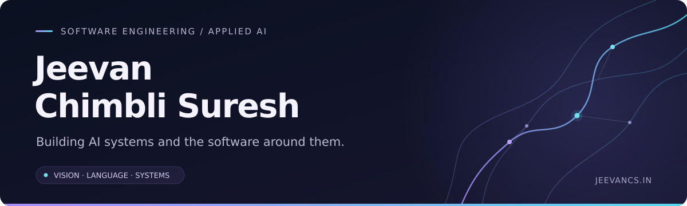

  

  <a href="https://jeevancs.in/"><strong>Portfolio ↗</strong></a> &nbsp; · &nbsp;
  <a href="https://www.linkedin.com/in/jeevan750"><strong>LinkedIn ↗</strong></a> &nbsp; · &nbsp;
  <a href="mailto:jeevannaidu750@gmail.com"><strong>Email ↗</strong></a>

  <strong>M.S. Applied AI @ Stevens</strong> &nbsp; / &nbsp; Former Product Engineer @ Infosys Finacle 
  Hoboken, New Jersey · From Bengaluru, India

---

### Hi, I'm Jeevan.

I build AI systems and the software around them. My work connects **computer vision, language models, and backend engineering**, from financial software at Infosys Finacle to research on how vision-language models use visual evidence.

I'm pursuing an **M.S. in Applied Artificial Intelligence at Stevens Institute of Technology**, with graduation expected in **May 2027**. I'm interested in AI engineering, software engineering, and research collaborations where careful evaluation matters as much as getting a system to run.

### 01 / Research in progress

> **When a model explains an image, does its answer actually depend on the evidence it cites?**

My master's thesis examines **visual claim support and answer dependence in vision-language models**, advised by **Prof. YD Yao**.

- Compare direct answering, standard explanations, and evidence-first prompting using **Qwen3-VL-4B-Instruct on GQA**.
- Check whether visual claims are supported by scene-graph annotations and identify unsupported claims.
- Test answer and explanation changes after visual interventions, with relevant-evidence and control comparisons.

This is ongoing experimental work. [More about my research →](https://jeevancs.in/#/research)

### 02 / Selected work

<table>
<tr>
<td width="50%" valign="top">
<h3>VIOLA</h3>

<strong>Video understanding & accessibility</strong>

A live video analysis pipeline combining object detection, speech transcription, and contextual insights. I designed the model architecture and led integration across the pipeline in a four-person team.

<code>YOLOv8</code> <code>Whisper</code> <code>GPT-4</code> <code>Python</code>

<a href="https://jeevancs.in/#/projects">Project overview ↗</a>
</td>
<td width="50%" valign="top">
<h3>ARC</h3>

<strong>Amazon review credibility</strong>

A team project combining MiniLM embeddings, Gradient Boosting, and purchase-verification rules. A FastAPI service powers an explanatory Chrome extension. I contributed to the project and co-authored the report.

<code>MiniLM</code> <code>scikit-learn</code> <code>FastAPI</code>

<a href="https://github.com/kayshaah/ARC">Team repository ↗</a>
</td>
</tr>
<tr>
<td width="50%" valign="top">
<h3>Monosonic</h3>

<strong>Expression-based music recommendations</strong>

A webcam-based prototype that uses facial-expression predictions to select music. I worked on the recommendation flow and application behavior.

<code>Python</code> <code>OpenCV</code> <code>DeepFace</code> <code>Pygame</code>

<a href="https://github.com/Jeevan750/Monosonic">Repository ↗</a>
</td>
<td width="50%" valign="top">
<h3>JeevanCS</h3>

<strong>Personal portfolio</strong>

My home for projects, research, and engineering experience. A responsive portfolio with a PHP API, MariaDB, and an admin workflow for enquiries.

<code>React</code> <code>PHP</code> <code>MariaDB</code> <code>Docker</code>

<a href="https://jeevancs.in/">Live website ↗</a>
</td>
</tr>
</table>

<strong>More projects across AI, web, mobile, and IoT</strong>

| Project | Work |
| :--- | :--- |
| **Sign Language Detection** | Gesture recognition for accessible text or speech; model approach, application flow, and testing. |
| **Named Entity Recognition** | Dataset creation and extraction logic for structured entities in unstructured text. |
| **Anomaly Detection** | Autoencoder experiments and hyperparameter tuning for anomaly detection. |
| **Image Caption Generator** | Dataset collection and testing for image-to-language descriptions. |
| **Demeter** | Android front end connecting food donors with NGOs. |
| **Stock Market Prediction** | Developed three of five prediction algorithms in a team study. |
| **Smart Home Face Recognition** | Python prototype for face-recognition door unlocking. |
| **Evara Ecommerce** | Responsive product-browsing interface using HTML, CSS, and JavaScript. |

[Explore the project collection →](https://jeevancs.in/#/projects)

### 03 / Engineering experience

**Infosys Finacle · EdgeVerve — Product Engineer**  
Aug 2024 – Aug 2025 · Bengaluru

Built Finacle Treasury web features, optimized C/C++ backend services on Linux, and worked on deployments using Docker, Kubernetes, Helm, and Ansible.

**Infosys Finacle · EdgeVerve — Software Engineering Intern**  
Feb 2024 – Jul 2024 · Bengaluru

Built a middle-layer application for financial-data validation and transformation using JSONata, JSLT, and JavaScript. Worked with SQL and MongoDB.

<strong>Earlier internships</strong>

- **TrackNerd — Student Intern** · Jul – Sep 2022  
  Developed Node.js and NestJS APIs for data transfer and real-time updates; tested and debugged APIs with Postman.
- **Digitran Solution Pvt Ltd — Project Intern** · Oct – Dec 2021  
  Built a Python smart-home prototype for face-recognition door unlocking and explored web/mobile integration.

### 04 / Tools I work with

| Area | Technologies |
| :--- | :--- |
| **Languages** | Python · C/C++ · Java · JavaScript · SQL · PHP |
| **AI & evaluation** | PyTorch · TensorFlow · scikit-learn · OpenCV · Hugging Face Transformers · VLMs · NLP · Visual grounding |
| **Web & APIs** | React · Node.js · NestJS · FastAPI · REST APIs · HTML/CSS |
| **Data systems** | PostgreSQL · MySQL/MariaDB · MongoDB · Oracle · Kafka |
| **Infrastructure** | Linux · AWS · Docker · Kubernetes · Helm · Ansible · Git · GitHub Actions |

### 05 / Education & publications

**Stevens Institute of Technology**  
M.S. Applied Artificial Intelligence · 2025 – May 2027 (expected)

**Dayananda Sagar University**  
B.E. Computer Science and Engineering, AI & ML · 2020 – 2024

<strong>Publications & coursework certificates</strong>

**VIOLA: Video Integration of Object Detection, Language, Insights and Accessibility**  
Jeevan CS, Jeramiah T Varghese, Kodanda Rama Raju Kasuru, Hridanshu Ruparel, Pradeep Kumar K.  
2nd International Student Conference on Multidisciplinary and Current Technical Research · 2024

**An Autonomous Robotic Vehicle (ARV) with Integrated Manipulation: Arduino-Based Control Approach**  
Pradeep Kumar, Jeevan CS, Srinidhi N, Manjushree T, Monika Agarwal, Shreyas J.  
International Conference Recent Advances in Science and Engineering (RAiSE) · 2023

**Additional learning**

- Machine Learning Specialization — Coursera / Stanford Online · Jul 2023
- Elements of AI — University of Helsinki / Reaktor · May 2022
- Dynamic Skills Integrated Program · Jul 2023

---

  <strong>Let's build something useful.</strong> 
  AI engineering · Software engineering · Research collaborations  
  <a href="mailto:jeevannaidu750@gmail.com">jeevannaidu750@gmail.com</a> &nbsp; · &nbsp;
  <a href="https://www.linkedin.com/in/jeevan750">LinkedIn</a> &nbsp; · &nbsp;
  <a href="https://jeevancs.in/">jeevancs.in</a>

